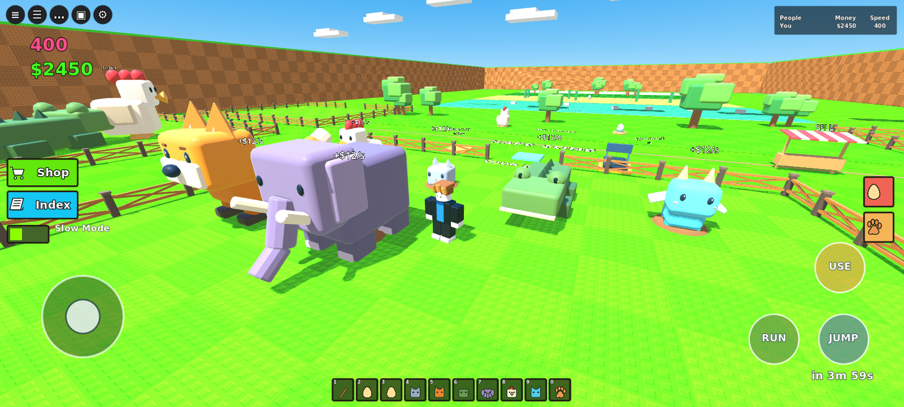

# Android 테스트 APK — v0.3.2

[APK 다운로드](https://github.com/lmo0317/roblox/raw/refs/heads/main/Builds/EggDash-Android.apk)

- Android **7.0 이상 (API 24)**, **ARM64** 기기, OpenGL ES 3 지원 필요
- 가로 화면, 앱 내 게임 데이터 포함, Godot 설치 불필요
- 개발용 디버그 키로 서명한 **직접 설치 테스트 APK**. Google Play 배포본이 아닙니다.
- 앱 ID: `com.eggdash.prototype`, 버전 0.3.2 / versionCode 4, Target SDK 36

휴대폰에서 APK를 내려받아 파일을 열고 설치합니다. 필요한 경우 해당 브라우저/파일 앱의 ‘알 수 없는 앱 설치’ 권한을 허용합니다.

## 조작

- 왼쪽 원형 패드: 이동
- 오른쪽 빈 화면 드래그: 카메라 회전
- JUMP: 점프 (누른 상태 유지 가능)
- RUN: 달리기 켜기/끄기
- USE: 알 획득 / 부화 / 가까운 강화 패드 사용
- Shop: 재화로 속도·기지 강화
- Android 뒤로 가기: 일시정지 메뉴

이동과 카메라, 점프는 서로 다른 손가락으로 동시에 사용할 수 있습니다. 앱이 백그라운드로 가면 진행 상황을 저장하고 터치 입력을 초기화합니다. 진행 상태는 앱 전용 저장 공간에 저장됩니다. PC 저장 파일과 자동 동기화되지는 않습니다.



위 이미지는 모바일 UI를 켠 데스크톱 Godot 렌더링이며, 안드로이드 기기 캡처가 아닙니다.

## 검증 범위

- Godot 실제 입력 이벤트를 사용해 이동 패드, 이동+카메라 동시 입력, 점프, 달리기 전환, 손 뗄 때 입력 초기화 확인
- 기존 게임 통합 테스트 및 14개 물리 이동 경로 검사 통과
- APK v2/v3 서명, ZIP 구조, 16 KiB 네이티브 라이브러리 정렬, ARM64 포함 여부 검사
- **실제 Android 기기·에뮬레이터 설치 및 프레임 성능은 미검증**

모바일은 3D 해상도 75%, MSAA 2×를 사용하고 작은 원거리 파트를 숨겨 부하를 줄입니다. UI는 화면 해상도로 렌더링합니다.

## 재빌드

Godot 4.6.3의 Android Export Templates, Java, Android SDK platform-tools 및 build-tools를 설치하고 Godot Editor Settings의 Java/Android SDK 경로를 설정합니다. Android Export preset은 기본 APK 템플릿을 사용하며 Gradle 빌드는 필요하지 않습니다.

```bash
godot --headless --path Godot --editor --import --quit
godot --headless --fixed-fps 60 --path Godot -- --smoke-test --mobile-ui
godot --headless --fixed-fps 60 --path Godot -- --movement-test
godot --headless --path Godot --export-debug Android /absolute/path/exported.apk
python Tools/fix_android_manifest.py /absolute/path/exported.apk /absolute/path/unsigned.apk
# Use SDK zipalign -P 16, then apksigner with your own debug keystore.
```

서명 키와 로컬 SDK 경로는 저장소에 넣지 않습니다. 다른 환경에서 다른 디버그 키로 빌드하면 기존 앱 위에 업데이트 설치할 수 없으므로 기존 앱 삭제가 필요할 수 있습니다.

Godot 4.6.3 템플릿 내보내기는 서로 다른 Android ContentProvider의 authority를 같은 값으로 바꾸므로, `Tools/fix_android_manifest.py`로 AndroidX 초기화 Provider만 분리한 뒤 정렬하고 다시 서명합니다. 최종 APK는 서로 다른 authority를 사용하는지 검사했습니다.
