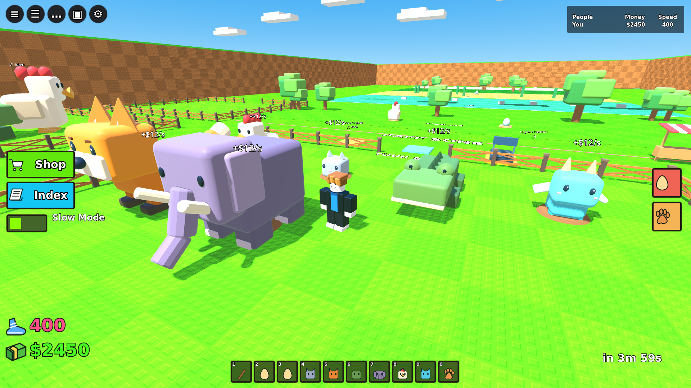

# Egg Dash — Godot 3D

로블록스식 블록 캐릭터와 단순한 지형으로 만든 **Godot 4.6.3 싱글플레이 프로토타입**입니다. 클라우드에서 Windows/Linux 실행 파일을 빌드합니다. Unity 원본은 비교용으로 보존하며, 현재 개발 버전은 `Godot/`입니다.

## 실제 게임 화면



현재 다운로드는 위 화면의 캐릭터·펫·여우·기지·환경·HUD가 반영된 그래픽 개선 버전입니다. 화면은 실제 런타임에서 알 운반 장면을 고정해 촬영했습니다.

## 바로 실행

저장소에 올린 실행 파일을 다운로드하고 압축을 풉니다.

- [Windows 다운로드](https://github.com/lmo0317/roblox/raw/refs/heads/main/Builds/EggDash-Windows.zip)
- [Linux 다운로드](https://github.com/lmo0317/roblox/raw/refs/heads/main/Builds/EggDash-Linux.zip)
- [SHA256 체크섬](Builds/SHA256SUMS.txt)

GitHub 릴리스 첨부 업로드가 현재 인증 구성에서 거절되어 `Builds/`에 직접 보관합니다.

- **Windows x86_64:** `EggDash-Windows.exe` 실행. Godot 설치 불필요. 서명되지 않은 프로토타입입니다.
- **Linux x86_64:** 실행 권한을 부여한 뒤 `./EggDash-Linux.x86_64` 실행. 그래픽 드라이버와 데스크톱 환경이 필요합니다.

PCK는 실행 파일에 내장되어 있습니다. Windows 빌드는 클라우드에서 생성했으며 Windows에서의 직접 실행은 확인하지 않았습니다.

## 조작

| 입력 | 기능 |
| --- | --- |
| WASD | 이동 |
| Space | 점프 |
| Shift | 달리기 |
| 마우스 오른쪽 버튼을 누르고 이동 | 카메라 회전 |
| E | 알 획득 / 부화 / 강화 |
| Esc | 일시정지 |

둥지에서 알을 가져와 여우의 추격을 피해 내 기지의 파란 **HATCH** 패드로 돌아오세요. E를 누르면 3초 후 부화하고 펫 한 마리당 초당 $12가 발생합니다. 오른쪽 트레드밀에서 속도, 왼쪽 노란 패드에서 기지 슬롯을 강화합니다. 희귀 알은 속도 레벨 3부터 획득하고 부화 시 추가 $150를 줍니다. 잡히면 알을 잃고 기지로 돌아옵니다.

진행 상태는 Godot `user://progress.json`에 자동 저장됩니다. 예: Windows `%APPDATA%/Godot/app_userdata/Egg Dash/progress.json`. 속도 최대 10레벨, 기지 확장 최대 3회, 펫 최대 12마리입니다.

## Godot에서 열기 / 빌드

1. Godot **4.6.3 Standard**에서 `Godot/project.godot`을 Import합니다.
2. F6 또는 F5로 실행합니다. 외부 에셋이나 플러그인이 필요하지 않습니다.
3. 같은 버전의 Export Templates를 설치하면 아래처럼 빌드할 수 있습니다.

```bash
godot --headless --path Godot --editor --import --quit
godot --headless --path Godot -- --smoke-test
mkdir -p dist
godot --headless --path Godot --export-release Windows "$PWD/dist/EggDash-Windows.exe"
godot --headless --path Godot --export-release Linux "$PWD/dist/EggDash-Linux.x86_64"
```

## 검증

Godot 실제 런타임에서 다음 시나리오를 헤드리스 통합 테스트합니다: 알 획득, 부화, 펫 수익, 속도/기지 구매, 희귀 알 레벨 제한과 부화 보너스, 수호 동물에게 잡혔을 때 복귀. 성공 시 `EGG_DASH_SMOKE_PASS`가 출력됩니다. Linux 내보내기 실행 파일에서도 동일 시나리오를 실행합니다. Linux 가상 디스플레이에서 내보낸 실행 파일의 실제 렌더링도 확인했습니다. Windows 직접 실행은 아직 수행하지 않았습니다.

## 범위

펫과 맵은 기본 도형으로 만든 원본이며 Roblox와 관련 없는 독립 프로젝트입니다. Steal An Egg의 알 운반·부화·강화 흐름을 참고했습니다. 멀티플레이, 타인 알 훔치기, 거래, 모바일 조작, 사운드는 포함하지 않습니다. 다른 기지는 장식입니다. UI는 영어입니다.

- `Godot/`: 현재 Godot 프로젝트와 통합 테스트
- `Assets/`, `Packages/`, `ProjectSettings/`: 이전 Unity 프로토타입 ([설명](Docs/Unity.md))
- `Docs/concept.png`: 생성형 콘셉트 이미지. 실제 플레이 화면과 다릅니다.

## 모델 제작

`Godot/assets/*.glb`는 이 프로젝트를 위해 Blender로 제작한 모델입니다. `blender -b --python Tools/generate_assets.py -- Godot/assets`로 다시 생성할 수 있습니다. 실행에는 Blender가 필요하지 않습니다.
